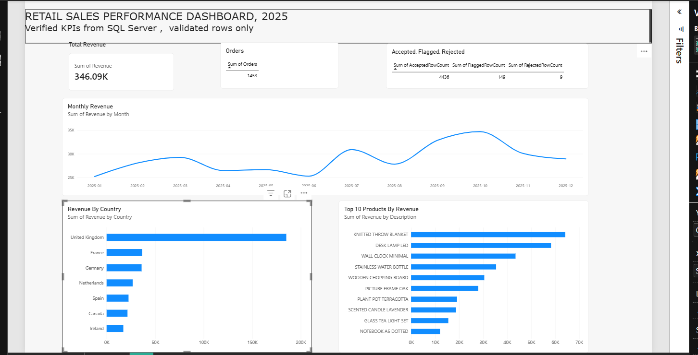

# AI-Powered Business Intelligence & Reporting Assistant

Upload a retail sales file, check its quality, calculate verified KPIs, store them in SQL Server,
and generate a draft business report. **Python and SQL calculate every number. The AI model only
explains verified metrics, and any number it cannot trace back to them is blocked.**



## What it does

1. **Ingest and profile** CSV or Excel files, with clear errors for bad files.
2. **Validate** every row and classify it as accepted, flagged or rejected. Nothing is deleted.
3. **Calculate KPIs in Python**: revenue, orders, average order value, unique customers, growth, acceptance rate.
4. **Store the validated rows in SQL Server** in one transaction per load. Re-uploading the same file is detected by its SHA-256 hash.
5. **Recalculate the KPIs in SQL** and reconcile them with Python (money within 0.01, counts exact).
6. **Explore** the results in a Streamlit dashboard with filters and charts.
7. **Export** an Excel KPI workbook, data-quality files and the report draft.
8. **Draft a report** with an AI model (Gemini, OpenAI or Anthropic) or a rule-based template. Every number is checked against the verified metrics.
9. **Visualise** in a Power BI dashboard that reads SQL Server views.

## Tech stack

Python 3.12, pandas, SQLAlchemy, pyodbc, SQL Server Express (T-SQL), Streamlit, Plotly, openpyxl, pytest, Power BI Desktop.

## Setup (Windows)

1. Install Python 3.12, SQL Server Express, SQL Server Management Studio and the Microsoft ODBC Driver 18 for SQL Server.
2. Create the environment and install packages:
   ```
   python -m venv .venv
   .venv\Scripts\activate
   pip install -r requirements.txt
   ```
3. In SSMS, create a database named `BIAssistant`, then run `sql/create_tables.sql` and `sql/views.sql`.
4. Copy `.env.example` to `.env` and fill in the values:
   ```
   DB_SERVER=.\SQLEXPRESS
   DB_NAME=BIAssistant
   LLM_PROVIDER=gemini
   LLM_MODEL=gemini-3.5-flash-lite
   LLM_API_KEY=your_key_here
   ```
   The AI key is optional. The template report works without one. Never commit `.env`.
5. Start the app:
   ```
   streamlit run app.py
   ```
6. On the Home page choose **Use sample dataset**, then **Save run to SQL Server**.

Run the tests with `pytest -q`.

## Verified results on the sample dataset

   The sample dataset is synthetic. It was generated by `data/generate_sample_data.py`, with data-quality problems injected on purpose to test the validation rules.

| Measure | Value |
|---|---|
| Rows in file | 4,594 |
| Accepted / flagged / rejected | 4,436 / 149 / 9 |
| Total revenue | 346,087.77 |
| Distinct orders | 1,453 |
| Average order value | 238.19 |
| Unique customers | 391 |
| Python vs SQL | Reconciled |

The same totals appear in the Streamlit dashboard, the SQL queries, the Excel workbook and Power BI.

## Project layout

```
app.py, pages/       Streamlit app (Home, Data Quality, Analytics Dashboard, AI Report, Export Center)
src/                 loader, profiler, validation, analytics, database, AI report, exports
sql/                 create_tables.sql, kpi_queries.sql, views.sql
powerbi/             Bi_Assistant.pbix
data/                sample dataset, its generator script, and test_files/ for edge cases
docs/                metric_dictionary.md, architecture.md
tests/               pytest suite (131 tests)
```

## Documentation

- [Metric dictionary](docs/metric_dictionary.md): definitions, limitations, validation rules and reference values.
- [Architecture](docs/architecture.md): data flow, components, safeguards and known limitations.

## Safeguards

- Python and SQL must agree before an AI report can be generated.
- Every number in an AI report must appear in the verified metrics, or the report is marked unverified and hidden.
- Only aggregated KPIs are sent to the AI: no raw rows, invoice numbers or customer IDs.
- API keys stay in `.env`, travel in request headers and are redacted from errors.
- CSV and Excel exports neutralise formula injection.
- Every report is labelled a draft that needs human review.

## Limitations

- Currency is not specified in the data.
- A partial final month understates revenue growth.
- Unique customers is a lower bound when `CustomerID` is missing.
- The AI check verifies numbers, not the claims written around them, so a person must review every draft.
- Built for one retail transaction schema.